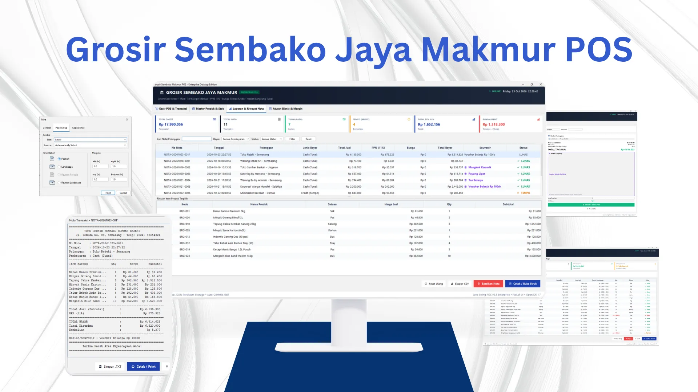
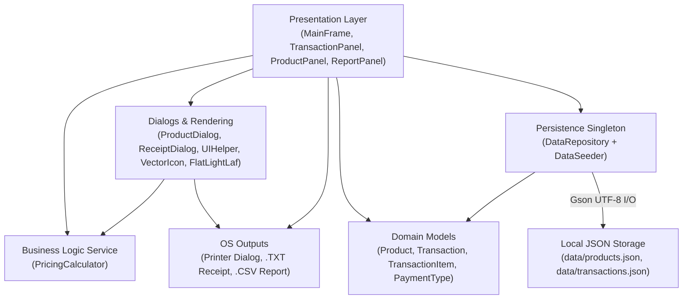
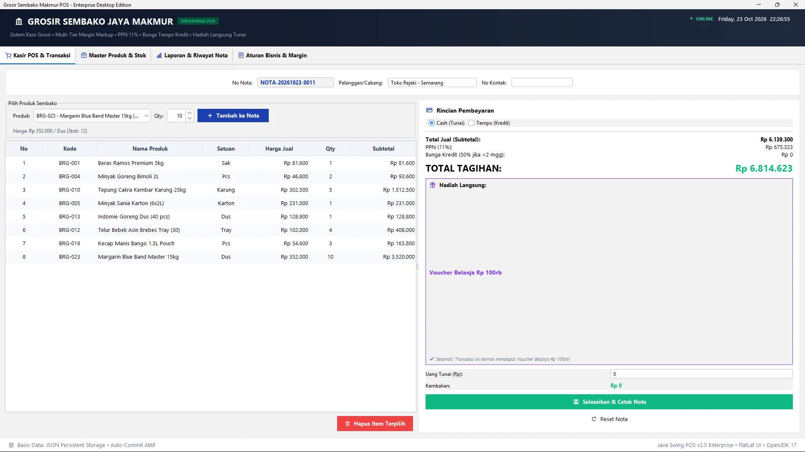
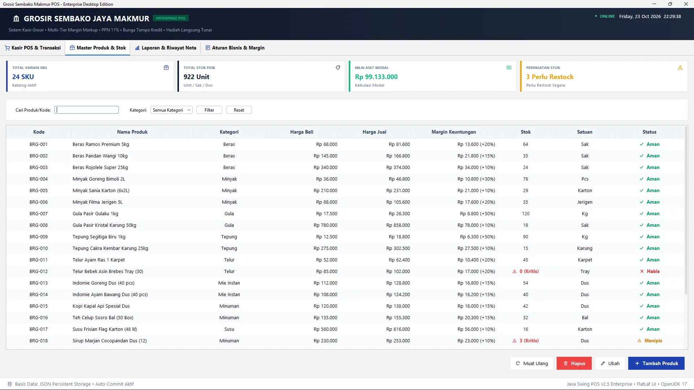
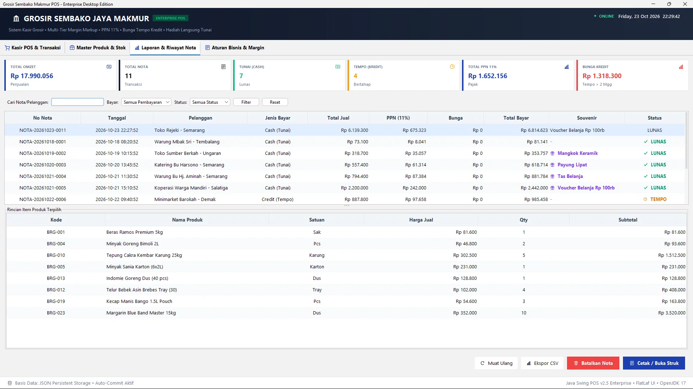
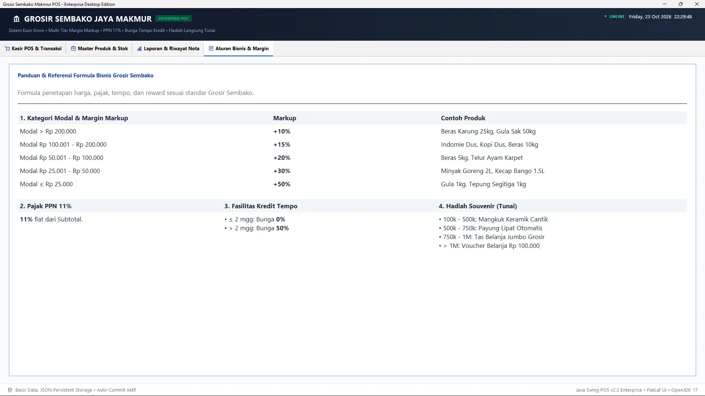
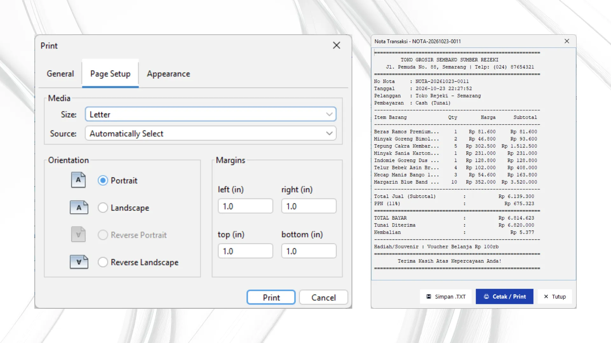

# Grosir Sembako Jaya Makmur POS




## Project Overview

**Grosir Sembako Jaya Makmur POS** is an offline-first Java Swing desktop Point-of-Sale and inventory management application built for wholesale grocery (*sembako*) retail operations. It addresses manual calculation errors and slow counter workflows by automating five-tier capital-based profit markup pricing, flat 11% VAT (*PPN*), credit tempo interest rules, cash souvenir reward tiers, real-time stock deductions, receipt printing, and CSV sales reporting backed by local JSON persistence.

## Key Features

- **POS Cashier & Cart Processing (`TransactionPanel`)**: Generates sequential daily invoice numbers (`NOTA-YYYYMMDD-XXXX`), validates available stock before adding items, supports live cart item removal, and enforces cash tender validation with real-time change or shortfall indicators.
- **Automated Pricing & Tax Engine (`PricingCalculator`)**: Calculates recommended selling prices across five purchase-price margin brackets (`+50%` for `<= Rp 25.000`, `+30%` for `Rp 25.001–50.000`, `+20%` for `Rp 50.001–100.000`, `+15%` for `Rp 100.001–200.000`, and `+10%` for `> Rp 200.000`, rounded to the nearest `Rp 100`), applies a flat `11%` VAT, and computes credit interest (`0%` for tempo `<= 2` weeks, `50%` for tempo `> 2` weeks).
- **Cash Souvenir Reward Evaluation**: Automatically awards tiered gifts on cash transactions (`Mangkok Keramik` for `Rp 100k–500k`, `Payung Lipat` for `> Rp 500k–750k`, `Tas Belanja` for `> Rp 750k–1M`, and `Voucher Belanja Rp 100rb` for `> Rp 1M`) and displays dynamic next-tier upsell hints.
- **Master Product & Inventory Management (`ProductPanel` & `ProductDialog`)**: Displays four live KPI cards (SKU count, total physical units, capital asset value, and low-stock alerts), supports keyword and category filtering, provides add/edit/delete CRUD dialogs with one-click markup price recommendations, and highlights critical/out-of-stock rows (`<= minStock`).
- **Sales Reports, Invoice History & CSV Export (`ReportPanel`)**: Aggregates six financial KPIs (total turnover, invoice count, cash count, credit count, total VAT, and total credit interest), filters transactions by keyword, payment type, and status (`LUNAS` / `BELUM LUNAS`), inspects line items in a split-pane view, cancels invoices with automatic stock restoration, and exports filtered tables to CSV.
- **Monospaced Receipt Printing & TXT Export (`ReceiptDialog`)**: Renders formatted transaction receipts with OS printer dialog integration (`JTextArea.print()`) and `.txt` file export via `JFileChooser`.
- **Built-in Business Rules Reference & Custom Vector Icons**: Includes an HTML formula guide tab (`Aturan Bisnis & Margin`) and a custom Java2D `VectorIcon` renderer for crisp UI icons alongside `FlatLightLaf` theming.

## Supported Platforms

| Platform | Operating System | Minimum Version | Support / Test Status |
| :--- | :--- | :--- | :--- |
| Windows Desktop | Windows (x64 / x86 with JVM) | Windows 10 (OpenJDK 17) | Configured (`compile.bat`, `run.bat`, `run.ps1`) and verified via UI execution and unit tests |

## Tech Stack

| Category | Technology | Purpose |
| :--- | :--- | :--- |
| Language & Runtime | Java (OpenJDK 17) | Core application logic, OOP domain models, and JVM desktop execution |
| Desktop UI Toolkit | Java Swing & AWT | Multi-tabbed desktop interface, split panes, dialogs, tables, and print API |
| Look & Feel Theme | FlatLaf (`flatlaf.jar`) | Modern flat light theme (`FlatLightLaf`) with rounded controls and custom table styling |
| Custom Graphics | Java2D (`VectorIcon`) | Anti-aliased scalable vector icons rendered natively via `Graphics2D` and `Path2D` |
| Serialization & Storage | Gson (`gson.jar`) & JSON | UTF-8 JSON persistence for `data/products.json` and `data/transactions.json` |
| Build & Launch Tooling | `javac`, Batch, PowerShell | Source compilation (`compile.bat`) and desktop launchers (`run.bat`, `run.ps1`) |

## Application Architecture

The application uses a modular three-tier desktop architecture built around `MainFrame` as the single-window shell. Presentation panels (`TransactionPanel`, `ProductPanel`, `ReportPanel`, and the embedded HTML business-rules panel) interact with `PricingCalculator` for deterministic financial rules and with the synchronized `DataRepository` singleton for thread-safe in-memory state and Gson JSON file persistence, while `DataSeeder` initializes default catalog and sample transaction records when data files are absent.



## Screenshots / Preview

### 1. POS Cashier & Transaction Screen

The primary cashier workspace (`Kasir POS & Transaksi`) pairs a left-hand invoice header, product selector with live stock readout, and line-item cart table against a right-hand payment breakdown panel. Cashiers can toggle between Cash and Credit Tempo modes while viewing real-time 11% VAT, credit interest, direct gift eligibility, and cash change calculations.

### 2. Master Product & Inventory Management Screen

The inventory workspace (`Master Produk & Stok`) summarizes catalog health across four top KPI cards and provides search-by-code/name and category filters above a sortable product table. Rows automatically surface profit margin amounts, percentages, and color-coded stock alerts (`Aman`, `Menipis`, `Habis`), paired with bottom CRUD controls.

### 3. Sales Reports & Invoice History Screen

The reporting workspace (`Laporan & Riwayat Nota`) presents six aggregate financial KPIs alongside multi-criteria filters for invoice search, payment method, and settlement status. A vertical split pane displays matching invoices on top and the selected invoice's itemized product breakdown below, with actions to reload, export CSV, cancel invoices (restoring stock), or reopen receipts.

### 4. Business Rules & Margin Reference Screen

The built-in reference tab (`Aturan Bisnis & Margin`) renders a structured HTML formula sheet inside the main window. It documents all five capital-to-markup tiers, the flat 11% VAT rate, credit tempo interest thresholds, and cash souvenir tiers for quick cashier verification.

### 5. Receipt Preview & System Print Dialog

After completing a transaction or reopening an invoice from reports, `ReceiptDialog` displays a monospaced wholesale receipt detailing store header, customer metadata, itemized quantities, VAT, interest, cash change, and souvenir earned. Operators can export the receipt as a `.txt` file or invoke the native OS Print dialog shown on the left.

## Prerequisites

- **Operating System**: Windows 10 or newer.
- **Java Development Kit (for compiling & running from source)**: OpenJDK 17 (or compatible JDK 17+) available on `PATH` or installed at `C:\Users\Dimas\jdk-17\bin`.
- **Bundled Dependencies**: `lib/flatlaf.jar` and `lib/gson.jar` (already included in the repository).

## Installation & Setup

1. Clone the repository and navigate into the project directory:

```powershell
git clone https://github.com/weztcy/Grosir-Sembako-Jaya-Makmur-POS.git
cd "Grosir Sembako Jaya Makmur POS"
```

2. Compile all Java source files into the `bin/` directory using the provided batch script (or directly with `javac`):

```bat
compile.bat
```

3. Verify the compiled business logic suite (optional):

```powershell
java -cp "bin;lib/*" com.grosir.sembako.test.TestBusinessLogic
```

## Application Configuration

No external environment files or database servers are required; operational defaults and paths are defined directly in source and launcher scripts.

| Configuration | Description | Default / Example |
| :--- | :--- | :--- |
| `DATA_DIR` (`DataRepository.java`) | Relative directory storing JSON product and transaction files | `data` (`data/products.json`, `data/transactions.json`) |
| `DEFAULT_TAX_RATE` (`PricingCalculator.java`) | Flat Value Added Tax (PPN) rate applied to transaction subtotal | `0.11` (`11%`) |
| `CREDIT_INTEREST_RATE` (`PricingCalculator.java`) | Interest rate applied to credit transactions exceeding 2 weeks | `0.50` (`50%` when `tempoWeeks > 2`) |
| `JAVAC_EXE` / `JAVA_EXE` (`compile.bat`, `run.bat`, `run.ps1`) | Explicit JDK 17 executable path with fallback to system `PATH` | `C:\Users\Dimas\jdk-17\bin\javac.exe` (falls back to `javac`/`java`) |
| FlatLaf UI Properties (`MainFrame.java`) | Window dimensions, rounded corner arcs, tab height, and alternating table row color | `1280x840` (`1100x720` min), `FlatLightLaf` |

## Database & Local Storage

All catalog and transaction records are persisted locally in UTF-8 JSON format through the thread-safe `DataRepository` singleton using Gson (`setPrettyPrinting()`). On startup, if `data/products.json` or `data/transactions.json` does not exist or fails to parse, `DataSeeder` automatically populates 24 initial grocery SKUs and 10 sample transactions.

| Storage Artefact | Purpose | Behavior |
| :--- | :--- | :--- |
| `data/products.json` | Stores `Product` catalog entries (code, name, category, purchase/selling prices, stock, unit, `minStock`) | Auto-saved on product CRUD updates, transaction checkout (stock deduction), and invoice cancellation (stock restoration) |
| `data/transactions.json` | Stores `Transaction` records with nested `TransactionItem` lists, tax, interest, souvenir, and status | Prepends new transactions at index `0` and immediately persists updates to disk |

```powershell
# Recompile and run unit verification against JSON repository & pricing formulas
compile.bat && java -cp "bin;lib/*" com.grosir.sembako.test.TestBusinessLogic
```

## Testing

The repository includes a standalone verification suite in `src/com/grosir/sembako/test/TestBusinessLogic.java` that exercises pricing tiers, tax, credit interest, souvenir rules, repository loading, and invoice sequence generation.

- **Pricing Tier Assertions**: Validates all five markup brackets (`> 200k`, `100k–200k`, `50k–100k`, `25k–50k`, and `<= 25k`).
- **Tax & Credit Interest Assertions**: Verifies `11%` VAT calculation and `0%` (`<= 2` weeks) vs `50%` (`> 2` weeks) credit interest rules.
- **Souvenir & Repository Checks**: Confirms cash-only gift tiers, `DataRepository` loading (`24` seeded products), and `NOTA-` invoice number generation (`11 PASSED, 0 FAILED`).

```powershell
java -cp "bin;lib/*" com.grosir.sembako.test.TestBusinessLogic
```

## Usage

Launch the desktop application after compilation using either the Windows batch script or the PowerShell launcher.

1. Start the application with `run.bat` or `.\run.ps1` (launches `com.grosir.sembako.ui.MainFrame` with `-cp "bin;lib/*"`).
2. In **Kasir POS & Transaksi**, enter the customer or branch store name, select products and quantities, click **Tambah ke Nota**, choose **Cash (Tunai)** or **Tempo (Kredit)** (with duration in weeks), enter cash received if paying cash, and click **Selesaikan & Cetak Nota** to commit the sale, deduct stock, and open the receipt dialog.
3. In **Master Produk & Stok**, search or filter SKUs by category and use **Tambah Produk**, **Ubah**, or **Hapus** to manage inventory; use **Pakai Rekomendasi** inside `ProductDialog` to auto-fill selling prices from the purchase price tier.
4. In **Laporan & Riwayat Nota**, filter historical invoices by keyword, payment type, or status (`LUNAS` / `BELUM LUNAS`), select any row to inspect its line items, or click **Ekspor CSV**, **Batalkan Nota**, or **Cetak / Buka Struk**.
5. Open **Aturan Bisnis & Margin** at any time to review pricing markup brackets, VAT, credit tempo interest, and cash gift thresholds.

## Contributing

Contributions to improve functionality, documentation, or test coverage are welcome through standard pull requests.

1. Fork the repository.
2. Create a feature or fix branch for your changes.
3. Implement your updates while preserving existing code structure and formatting.
4. Compile with `compile.bat` and run `TestBusinessLogic` to validate business rules.
5. Commit and push your branch to your fork.
6. Open a pull request with a clear explanation of the changes.

## License

This project is licensed under the MIT License.
See the [LICENSE](LICENSE) file for details.

## Author & Contact

**Yohanes Dimas Pratama**

- GitHub: [github.com/weztcy](https://github.com/weztcy)
- Portfolio: [yohanesdimas.com](https://yohanesdimas.com)
- LinkedIn: [linkedin.com/in/yohanes-dimas](https://www.linkedin.com/in/yohanes-dimas)
