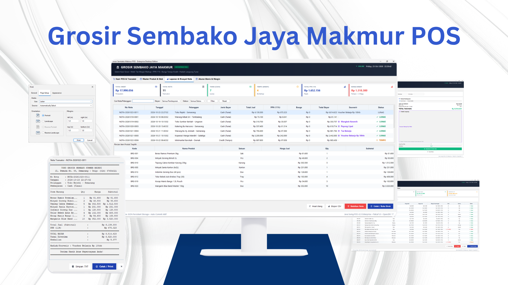

# Grosir Sembako Jaya Makmur POS

[](https://openjdk.org/)
[-orange?logo=openjdk&logoColor=white)](https://openjdk.org/)
[-5382A1?logo=java&logoColor=white)](https://www.formdev.com/flatlaf/)
[-4479A1?logo=json&logoColor=white)](https://github.com/google/gson)
[](#features)
[-success?logo=junit5&logoColor=white)](#testing)
[](./LICENSE)

<p align="center">
  
</p>

**Grosir Sembako Jaya Makmur POS** is a standalone enterprise desktop Point of Sale (POS) and inventory management system engineered specifically for high-volume wholesale grocery depots, staples distributors (*distributor sembako*), and neighborhood supply depots. Designed to replace error-prone manual ledger bookkeeping, the application unifies fast checkout operations, automated wholesale markup calculations, Value-Added Tax compliance, credit term tracking, customer promotional rewards, and thermal receipt printing within a single, distraction-free desktop interface.

The application is built on Java SE 17 and Swing, styled with the modern **FormDev FlatLaf Light** look-and-feel, and enhanced with resolution-independent Java2D vector iconography. Architected with an offline-first philosophy, Grosir Sembako Jaya Makmur POS utilizes local JSON persistence powered by Google Gson, completely eliminating the complexity, latency, and maintenance overhead of external database servers (such as MySQL or PostgreSQL). All transactions enforce inventory consistency, automatic stock decrementing upon sale, and stock restoration upon transaction cancellation.

---

## Features

- **High-Velocity Cashier POS Terminal (`TransactionPanel`)**:
  - **Dynamic Multi-Item Cart**: Rapidly stage wholesale commodities with automatic row numbering, unit specification (*Sak, Dus, Karton, Kg, Pcs, Karpet*), unit price formatting, quantity spinners, and instant subtotal recalculation.
  - **Warehouse Stock Guard**: Validates staged quantities in real time against on-hand warehouse inventory, blocking overselling and displaying instant warning dialogues.
  - **Invoice Sequence Generator**: Automatically constructs sequential, date-stamped audit invoice identifiers (`NOTA-YYYYMMDD-XXXX`).
  - **Live Cash Flow & Change Calculator**: Real-time tender calculation that validates cash handed by customers, displays instant change return figures, and alerts cashiers in red when payment is insufficient.

- **Automated Multi-Tier Wholesale Margin Engine (`PricingCalculator`)**:
  - Implements an automated cost-plus pricing strategy categorized by supplier acquisition cost (*Harga Beli / Modal*):
    - **Acquisition Cost > Rp 200,000**: **+10% Markup** (e.g., Beras Karung 25kg, Gula Sak 50kg)
    - **Acquisition Cost Rp 100,001 – Rp 200,000**: **+15% Markup** (e.g., Indomie Dus, Minyak Sania Karton)
    - **Acquisition Cost Rp 50,001 – Rp 100,000**: **+20% Markup** (e.g., Beras 5kg, Telur Ayam 1 Karpet)
    - **Acquisition Cost Rp 25,001 – Rp 50,000**: **+30% Markup** (e.g., Minyak Goreng 2L, Kecap Bango 1.5L)
    - **Acquisition Cost $\le$ Rp 25,000**: **+50% Markup** (e.g., Gula Pasir 1kg, Tepung Terigu 1kg)
  - Automatic rounding to the nearest hundred rupiah (Rp 100) to ensure uniform retail and wholesale cash handling.

- **Indonesian Tax & Flexible Payment Terms (`PaymentType`)**:
  - **Value-Added Tax (PPN 11%)**: Flat 11% tax computation automatically applied across all taxable wholesale goods.
  - **Cash vs. Credit (Tempo) Modes**:
    - **Cash (Tunai)**: Immediate settlement, automatic change computation, and eligibility for instant promotional gifts.
    - **Credit (Tempo)**: Configurable repayment horizon in weeks ($1\text{--}52\text{ weeks}$) with automatic due-date projection (`dueDate`).
    - **Late & Extended Horizon Penalty**: Credit terms $\le 2\text{ weeks}$ carry **0% interest surcharge** (grace period for established retail partners); terms $> 2\text{ weeks}$ automatically incur a **50% flat interest charge** on the subtotal.
  - **Settlement Status Tracking**: Explicit labeling of transactions as either `LUNAS` (settled) or `BELUM LUNAS` (pending payment).

- **Promotional Souvenir & Customer Incentive System**:
  - Direct tiered promotional gifts awarded exclusively to cash purchases (*Tunai*) to stimulate prompt cash flow:
    - **Rp 100,000 – Rp 500,000**: Mangkuk Keramik Cantik
    - **Rp 500,001 – Rp 750,000**: Payung Lipat Otomatis
    - **Rp 750,001 – Rp 1,000,000**: Tas Belanja Jumbo Grosir
    - **> Rp 1,000,000**: Voucher Belanja Tunai Rp 100.000
  - Live upselling hints displayed dynamically during cart assembly (e.g., *"Belanja Rp 15.000 lagi untuk dapat Payung Lipat!"*).
  - Credit transactions automatically disqualified from gift disbursements (`Tidak Ada`).

- **Warehouse Master Inventory Management (`ProductPanel`, `ProductDialog`)**:
  - **Comprehensive CRUD Operations**: Create, inspect, modify, and delete SKU records with category grouping, acquisition cost, selling price, unit type, and minimum threshold.
  - **Inventory Health Indicators**:
    - `Aman` (Green): Stock healthy and above minimum safety buffer.
    - `Menipis` (Amber): Stock at or below defined safety threshold (`minStock`), flagging reorder requirement.
    - `Habis` (Red): Stock fully depleted ($0\text{ units}$), disallowing cart addition.
  - **Executive KPI Dashboard**: Instant stat widgets displaying Total Active SKU Count, Total Physical Units in Warehouse, Total Asset Valuation (*Nilai Aset Modal*), and Urgent Restock Warnings.
  - **One-Click Margin Recommender**: Built-in "Pakai Rekomendasi" action inside product editing dialogs that applies standard business margin rules to set compliant selling prices.

- **Sales Ledger, Master-Detail Audit & Reporting (`ReportPanel`)**:
  - Complete historical transaction log with multi-criteria filtering by invoice number, customer name, payment scheme, and settlement status.
  - Interactive master-detail view: clicking any invoice row instantly loads its itemized product breakdown.
  - Financial overview cards summarizing Total Gross Revenue (Omzet), Total Invoices, Cash vs. Credit count, Total PPN Collected, and Total Credit Interest Accrued.
  - One-click RFC 4180 compliant CSV ledger export (`Laporan_Transaksi_Grosir.csv`).
  - Transaction cancellation with automatic warehouse stock reversal.

- **Receipt & Thermal Printer Dialog (`ReceiptDialog`)**:
  - Monospaced 58mm/80mm thermal receipt generator featuring store metadata, customer information, itemized purchase breakdown, tax and interest schedules, and gift announcements.
  - Direct hardware print spooling through the standard Java Print Service (`receiptArea.print()`).
  - Text-based receipt document archiving (`.txt` file export).

- **Modern Visual Experience & Custom Java2D Vector Engine**:
  - Styled with FormDev FlatLaf Light Look & Feel featuring smooth rounded corners, subtle elevation, and alternate table row coloring.
  - Pure Java2D vector icon generator (`VectorIcon`) rendering crisp iconography at any screen resolution without raster asset bloat.
  - Live real-time header clock tracking active cashier shifts.

---

## Preview & Demo

### Point of Sale Cashier Terminal


_The main cashier checkout terminal displaying customer profile headers, commodity selection dropdown with real-time stock hints, shopping cart table, payment breakdown (Subtotal, PPN 11%, Credit Interest, Total Tagihan), direct souvenir reward card, and cash tender calculator._

### Warehouse Master Inventory & Stock Catalog


_The master inventory management panel featuring real-time KPI stat cards (Total SKU Varian, Total Stok Fisik, Nilai Aset Modal, Peringatan Stok), search bar, category filter, and inventory table with color-coded stock safety badges._

### Historical Sales Ledger & Master-Detail Audit


_The reporting ledger showing financial KPI summary cards (Total Omzet, Total Nota, Tunai, Tempo, PPN, Bunga Kredit), searchable transaction log with payment status badges, and an interactive lower detail table showing itemized line entries._

### Business Rules & Margin Tier Reference


_In-app commercial reference guide outlining the multi-tier wholesale cost markup tiers, flat 11% PPN taxation rules, credit tempo interest brackets, and tiered direct souvenir incentive brackets for cash transactions._

### Thermal Receipt Preview & Printing Dialog


_58mm/80mm monospaced thermal receipt preview window displaying store headers, timestamp, itemized quantity/pricing grid, tax breakdown, gift summary, and integrated print/save buttons._

---

## Platform Support

| Operating System | Configured Target | Tested Status | Distribution Artifact |
| :--- | :---: | :---: | :--- |
| **Windows** (10 / 11, x86_64) | Yes | Verified on Windows 11 x64 | Batch (`run.bat`), PowerShell (`run.ps1`), Java Bytecode |
| **macOS** (Intel / Apple Silicon) | Yes | Supported via OpenJDK 17+ | Cross-platform Java Bytecode (`java -cp "bin:lib/*"`) |
| **Linux** (x86_64, ARM64) | Yes | Supported via OpenJDK 17+ | Cross-platform Java Bytecode (`java -cp "bin:lib/*"`) |

> [!NOTE]
> The application is 100% cross-platform and runs on any desktop environment equipped with a standard Java Runtime Environment (JRE 17 or higher) with AWT/Swing graphical subsystem support.

---

## Tech Stack

### Core Runtime & Language
- **Language**: Java SE 17 (`source=17`, `target=17`), OpenJDK / Eclipse Temurin 17 LTS
- **Architecture**: Desktop Client POS with In-Memory Caching and Persistent File Storage
- **Package Namespace**: `com.grosir.sembako`

### Graphical User Interface (GUI)
- **Framework**: Java Swing & Abstract Window Toolkit (AWT)
- **Look and Feel**: FormDev FlatLaf Light 3.x (`flatlaf.jar`)
- **Iconography**: Custom Java2D Vector Graphic Engine (`VectorIcon.java`) rendering anti-aliased geometry via `Graphics2D`
- **Layout Management**: `BorderLayout`, `GridBagLayout`, `FlowLayout`, `BoxLayout`, `JSplitPane`

### Data Storage & Serialization
- **Serialization Engine**: Google Gson 2.10+ (`gson.jar`)
- **Storage Strategy**: Local JSON flat-file storage (`data/products.json`, `data/transactions.json`) with UTF-8 character encoding and pretty printing
- **Concurrency**: Thread-safe synchronized repository methods (`DataRepository.java`)

### Document Export & Hardware Printing
- **Thermal Receipt Spooler**: Java Print Service API (`receiptArea.print()`)
- **Document Export**: RFC 4180 CSV Export (`Laporan_Transaksi_Grosir.csv`) and Plaintext Receipt Generator (`.txt`)

---

## Prerequisites

### For End Users & Store Cashiers
- **Java Runtime Environment (JRE)**: Version 17 or higher installed and accessible via system path (`java -version`).
- **Operating System**: Windows 10/11, macOS 11+, or Linux desktop environment.
- **Display Resolution**: Minimum recommended resolution of $1280 \times 800$ pixels.
- **Thermal Printer (Optional)**: Any standard 58mm or 80mm thermal receipt printer configured in the OS printer queue.

### For Software Developers
- **Java Development Kit (JDK)**: JDK 17 LTS or newer (Adoptium Temurin 17, Oracle JDK 17, or Microsoft OpenJDK 17).
- **Shell / Terminal**: Windows PowerShell or standard Bash terminal.
- **IDE (Optional)**: IntelliJ IDEA, Eclipse, Apache NetBeans, or Visual Studio Code.

---

## Installation & Setup

### 1. Acquire the Repository
Clone the project repository to your local workstation:

```bash
git clone https://github.com/weztcy/Grosir-Sembako-Jaya-Makmur-POS.git
cd "Grosir Sembako Jaya Makmur POS"
```

### 2. Verify Classpath Dependencies
All required external JAR libraries are bundled directly in the `lib/` directory:
- `lib/flatlaf.jar`: FormDev FlatLaf modern UI engine.
- `lib/gson.jar`: Google Gson JSON parser and serializer.

No external package managers (Maven or Gradle) are required to build or execute the project.

### 3. Compile the Application

#### Option A: Using the Automated Windows Batch Script
Execute `compile.bat` from the root directory:

```cmd
compile.bat
```

#### Option B: Using PowerShell / Manual Compiler Command
```powershell
# Gather all source files and compile to the bin/ directory
powershell -Command "Get-ChildItem -Recurse -Filter *.java src | ForEach-Object { '\"' + ($_.FullName -replace '\\', '/') + '\"' } | Set-Content -Encoding ascii sources.txt"
javac -encoding UTF-8 -cp "lib/*" -d bin @sources.txt
Remove-Item sources.txt
```

#### Option C: Using Linux / macOS Terminal
```bash
mkdir -p bin
find src -name "*.java" > sources.txt
javac -encoding UTF-8 -cp "lib/*" -d bin @sources.txt
rm sources.txt
```

---

## Environment Variables & Configuration

The application requires zero external environment variables, cloud API tokens, or database configuration files. Local configuration parameters and file paths are centralized within the code:

| Parameter | Location | Default Value | Description |
| :--- | :--- | :--- | :--- |
| **Product Storage File** | `DataRepository.java` | `data/products.json` | JSON file persisting active commodity catalog and warehouse stock |
| **Transaction Ledger File** | `DataRepository.java` | `data/transactions.json` | JSON file persisting all completed invoice and settlement records |
| **Default Tax Rate (PPN)** | `PricingCalculator.java` | `0.11` (11%) | Flat Value-Added Tax percentage applied to sales |
| **Credit Penalty Interest** | `PricingCalculator.java` | `0.50` (50%) | Surcharge rate applied to credit terms exceeding 2 weeks |
| **Credit Grace Period** | `PricingCalculator.java` | `2 weeks` | Maximum credit duration eligible for 0% interest |
| **Minimum Stock Threshold** | `Product.java` | `5 units` | Default safety stock threshold triggering restock warnings |

> [!NOTE]
> If `data/products.json` or `data/transactions.json` are not found upon launch, the application automatically initializes the files with seed data via `DataSeeder.java`.

---

## Usage / Getting Started

### Launching the Application

#### Via Windows Batch File:
```cmd
run.bat
```

#### Via Windows PowerShell Launcher:
```powershell
.\run.ps1
```

#### Via Direct Java Command (Cross-Platform):
```bash
# Windows
java -cp "bin;lib/*" com.grosir.sembako.ui.MainFrame

# Linux / macOS
java -cp "bin:lib/*" com.grosir.sembako.ui.MainFrame
```

### Core Operational Workflows

#### 1. Processing a Wholesale Cashier Sale
1. Navigate to the **Kasir POS & Transaksi** tab.
2. Verify or update the customer or branch store name in **Pelanggan/Cabang** (e.g., `Toko Rejeki - Semarang`).
3. Select a commodity from the **Produk** dropdown menu.
4. Enter the purchase quantity using the **Qty** spinner (validated against remaining stock).
5. Click **Tambah ke Nota** to add the line item to the active transaction cart.
6. Select the payment method:
   - **Cash (Tunai)**: Enter the cash received in **Uang Tunai (Rp)**. The system computes change in green or flags underpayment in red. Any earned promotional gift is displayed in the purple **Hadiah Langsung** card.
   - **Tempo (Kredit)**: Specify the payment horizon in weeks. If $> 2\text{ weeks}$, a 50% interest surcharge is computed automatically, and the projected due date is scheduled.
7. Click **Selesaikan & Cetak Nota**. The invoice is committed, warehouse stock is decremented, and the **Nota Transaksi** thermal dialog is displayed.

#### 2. Managing Warehouse Stock and Master Data
1. Select the **Master Produk & Stok** tab.
2. Review executive summary metrics (Total SKU, Total Units, Asset Value, Low Stock Alerts).
3. Search commodities using the search box or filter by category (*Beras, Minyak, Gula, Tepung, Telur, Mie Instan*, etc.).
4. Click **Tambah Produk** to register a new commodity:
   - Input Product Code, Name, Category, Acquisition Cost, Stock, and Unit.
   - Click **Pakai Rekomendasi** to have the system calculate the standard wholesale selling price using commercial markup rules.
5. Click **Simpan** to persist the SKU directly to `data/products.json`.

#### 3. Auditing Sales & Exporting Ledgers
1. Switch to the **Laporan & Riwayat Nota** tab.
2. Filter the transaction registry by invoice keyword, payment type (*Cash* or *Credit*), or settlement status (*LUNAS* or *BELUM LUNAS*).
3. Click any row in the ledger table to inspect the itemized product details in the lower panel.
4. Click **Cetak / Buka Struk** to re-open the thermal receipt dialog for reprint or digital inspection.
5. Click **Ekspor CSV** to export the entire ledger to an external spreadsheet file (`Laporan_Transaksi_Grosir.csv`).

---

## Available Scripts / Commands

| Command / Script | Environment | Description |
| :--- | :--- | :--- |
| `compile.bat` | Windows CMD | Compiles all Java source code in `src/` to `bin/` with UTF-8 encoding |
| `run.bat` | Windows CMD | Launches the main application (`com.grosir.sembako.ui.MainFrame`) |
| `.\run.ps1` | PowerShell | Launches the application with formatted console headers |
| `java -cp "bin;lib/*" com.grosir.sembako.test.TestBusinessLogic` | CLI / Shell | Executes the complete business logic and calculation verification test suite |
| `java -cp "bin;lib/*" com.grosir.sembako.util.CaptureScreenshots` | CLI / Shell | Programmatically launches the application and captures UI screenshots to `screenshots/` |

---

## Permissions & Device Requirements

- **File System Read/Write Access**:
  - Unrestricted read/write access to the local `./data` folder to persist and modify `products.json` and `transactions.json`.
  - User permissions to save generated `.csv` and `.txt` files through file chooser dialogues.
- **Printer & Spooling Subsystem**: Access to the host operating system's standard print spooler service when issuing physical thermal receipt print commands.
- **Zero Network Permissions**: The application operates completely offline. No outbound sockets, cloud telemetry, or internet access are utilized.

---

## Data Storage & Synchronization

All application records are persisted directly to disk using structured JSON documents managed by `DataRepository.java`:

- **Data Models**:
  - `data/products.json`: Array of `Product` records storing unique code, title, category, purchase price, selling price, on-hand inventory count, measurement unit, and minimum restock threshold.
  - `data/transactions.json`: Array of `Transaction` records storing invoice IDs, timestamps, customer details, itemized line entries (`TransactionItem`), subtotal, PPN, interest charges, total payment, cash received, change, souvenir name, and payment status.
- **Transactional Stock Integrity**:
  - **Stock Decrement on Commit**: When a sale is processed, `DataRepository.reduceStock()` immediately decrements on-hand quantities across all purchased line items.
  - **Stock Restoration on Rollback**: If an invoice is deleted or cancelled via `deleteTransaction()`, `DataRepository.restoreStock()` restores all line quantities back to the warehouse catalog, preventing phantom stock losses.
- **Offline Resilience**: The system operates with zero external server dependencies. Data remains completely private, secure, and immune to network outages.

---

## Testing

The project includes an automated test verification harness (`com.grosir.sembako.test.TestBusinessLogic`) that validates all commercial math, margin tiers, tax policies, interest logic, and repository seeding.

### Running the Test Suite
Execute the test runner from the root directory:

```bash
# Windows
java -cp "bin;lib/*" com.grosir.sembako.test.TestBusinessLogic

# Linux / macOS
java -cp "bin:lib/*" com.grosir.sembako.test.TestBusinessLogic
```

### Verified Test Assertions (11/11 Passed)

```text
=== RUNNING BUSINESS LOGIC TESTS ===
 [PASS] Markup > 200k: 250k -> 275k (10%)
 [PASS] Markup 100k-200k: 150k -> 172.5k (15%)
 [PASS] Markup 50k-100k: 60k -> 72k (20%)
 [PASS] Markup 25k-50k: 30k -> 39k (30%)
 [PASS] Markup <= 25k: 10k -> 15k (50%)
 [PASS] PPN 11%: 1,000,000 -> 110,000
 [PASS] Credit tempo 2 weeks interest = 0%
 [PASS] Credit tempo 3 weeks interest = 50%
 [PASS] Souvenir rules and legacy tiers validated (100% match)
 [PASS] Data repository loaded 24 products
 [PASS] Invoice sequence generated: NOTA-20261031-0010
=== TEST SUMMARY: 11 PASSED, 0 FAILED ===
```

---

## Build & Packaging

To package the compiled application into a distributable standalone JAR archive:

### 1. Compile Source Code
Ensure the `bin/` directory contains current class files:
```bash
javac -encoding UTF-8 -cp "lib/*" -d bin @sources.txt
```

### 2. Package into Executable JAR
Create an executable JAR configured with the main class:
```bash
jar cfe GrosirSembakoPOS.jar com.grosir.sembako.ui.MainFrame -C bin .
```

### 3. Distribution Requirements
When distributing the application to client machines:
1. Provide `GrosirSembakoPOS.jar`.
2. Include the `lib/` directory (`flatlaf.jar`, `gson.jar`) adjacent to the JAR, or run with classpath:
   ```bash
   java -cp "GrosirSembakoPOS.jar;lib/*" com.grosir.sembako.ui.MainFrame
   ```
3. Include the `data/` directory (or allow the app to initialize default seed data automatically on first launch).

---

## License

Please see the [LICENSE](./LICENSE) file for the terms and conditions governing the use, modification, and distribution of this project.

---

## Author & Contact

**Yohanes Dimas Pratama**

- GitHub: [github.com/weztcy](https://github.com/weztcy)
- Portfolio: [dimaspratama.vercel.app](https://dimaspratama.vercel.app)
- LinkedIn: [linkedin.com/in/yohanes-dimas](https://www.linkedin.com/in/yohanes-dimas)
